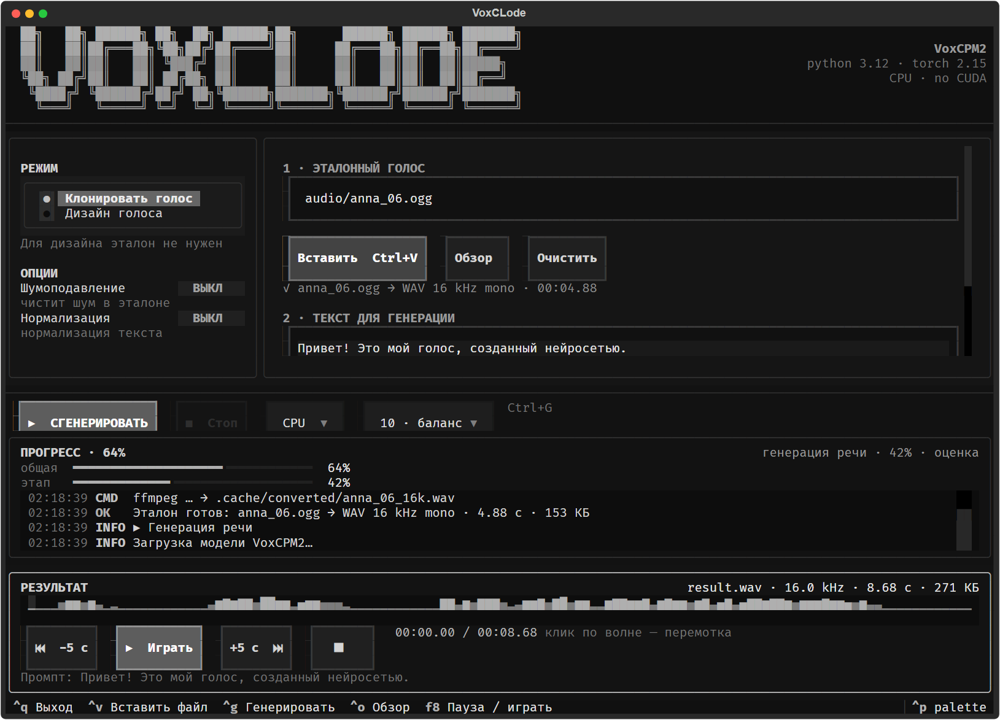

# VoxCLode

**VoxCLode** — яркий консольный клиент для [VoxCPM2](https://github.com/OpenBMB/VoxCPM): клонирование голоса по короткому аудио и генерация нового голоса по текстовому описанию. Интерфейс построен на [Textual](https://textual.textualize.io/), поэтому работает мышью и с клавиатуры прямо в терминале.



> Это не официальный проект OpenBMB. VoxCPM2 распространяется отдельно под Apache-2.0; веса модели скачиваются с Hugging Face при первом запуске.

---

## Содержание

- [Что умеет](#что-умеет)
- [Быстрый старт](#быстрый-старт)
  - [Windows · PowerShell](#windows--powershell)
  - [Windows · CMD](#windows--cmd)
  - [Ubuntu / Debian / Kali / Parrot](#ubuntu--debian--kali--parrot)
  - [Arch Linux / Manjaro](#arch-linux--manjaro)
  - [macOS](#macos)
- [Первый запуск и веса модели](#первый-запуск-и-веса-модели)
- [Как пользоваться](#как-пользоваться)
- [Горячие клавиши](#горячие-клавиши)
- [Режимы и опции](#режимы-и-опции)
- [Аудиоформаты и конвертация](#аудиоформаты-и-конвертация)
- [Плеер и волна](#плеер-и-волна)
- [GPU / CUDA](#gpu--cuda)
- [CLI без интерфейса](#cli-без-интерфейса)
- [Переменные окружения и секреты](#переменные-окружения-и-секреты)
- [Структура проекта](#структура-проекта)
- [Тесты](#тесты)
- [Диагностика](#диагностика)
- [Ограничения](#ограничения)
- [Публикация на GitHub](#публикация-на-github)
- [Лицензия и благодарности](#лицензия-и-благодарности)

---

## Что умеет

- **Два режима**: клонирование голоса по эталону и дизайн нового голоса по текстовому описанию.
- **Вставка файла из буфера**: `Ctrl+V` понимает файл, скопированный в Проводнике Windows, или путь к файлу в текстовом буфере.
- **Drag-and-drop**: перетащите аудиофайл в поле пути (Windows Terminal вставляет путь как текст).
- **Ручной путь**: можно ввести полный путь к эталону.
- **Автоконвертация** `wav`, `mp3`, `ogg`, `flac`, `m4a`, `mp4`, `webm`, `aac`, `wma`, `opus`, `aiff` и других форматов в WAV **16 kHz mono PCM16** — именно это ожидает VoxCPM.
- **Подробный прогресс**: общий процент, процент текущего этапа, время, лог команд, параметров и файлов.
- **Встроенный плеер**: пауза/продолжение, перемотка ±5 секунд, клик по волне для перемотки, отображение позиции, длительности, размера файла и промпта.
- **Локальный кэш**: модель и промежуточные WAV лежат в `.cache/` проекта, а не в профиле пользователя.
- **Кроссплатформенность**: Textual, конвертация через ffmpeg, плеер через Windows MCI (Windows) или `ffplay` (Linux/macOS).

---

## Быстрый старт

### Общие требования

| Компонент | Требование |
| --- | --- |
| Python | **3.10–3.12**. Версия 3.13+ не поддерживается VoxCPM |
| FFmpeg | нужен для конвертации и воспроизведения на Linux/macOS |
| Диск | ~8 ГБ: окружение + веса VoxCPM2 (~4.7 ГБ) |
| RAM | желательно 16 ГБ; на CPU генерация идёт медленно |
| GPU | опционально, NVIDIA + CUDA ≥ 12.0 |
| ОС | Windows 10/11, Linux, macOS |

Клонируйте репозиторий:

```bash
git clone https://github.com/geekAmis/voxclode.git
cd voxclode
```

> Если репозиторий ещё не опубликован, создайте папку проекта и выполните команды ниже в её корне.

### Windows · PowerShell

```powershell
# 1. Python 3.12 (если ещё нет)
winget install -e --id Python.Python.3.12
# или скачайте с https://www.python.org/downloads/windows/

# 2. FFmpeg (если ещё нет)
winget install -e --id Gyan.FFmpeg
# после установки перезапустите терминал, чтобы обновился PATH

# 3. Виртуальное окружение
py -3.12 -m venv .venv
.\.venv\Scripts\Activate.ps1

# Если PowerShell блокирует активацию:
# Set-ExecutionPolicy -Scope CurrentUser RemoteSigned

# 4. Зависимости
python -m pip install --upgrade pip
python -m pip install -r requirements.txt

# 5. Запуск
python voxclode.py
# или
.\run-voxclode.ps1
```

Если `py` не установлен, используйте `python` (убедитесь, что это 3.10–3.12: `python --version`).

### Windows · CMD

```bat
REM 1. Python 3.12 и FFmpeg
winget install -e --id Python.Python.3.12
winget install -e --id Gyan.FFmpeg

REM 2. Окружение
py -3.12 -m venv .venv
.venv\Scripts\activate.bat

REM 3. Зависимости
python -m pip install --upgrade pip
python -m pip install -r requirements.txt

REM 4. Локальный кэш (по желанию; иначе кэш уйдёт в профиль)
set HF_HOME=%CD%\.cache\huggingface
set HF_HUB_CACHE=%CD%\.cache\huggingface\hub

REM 5. Запуск
python voxclode.py
```

### Ubuntu / Debian / Kali / Parrot

```bash
# 1. Системные пакеты
sudo apt update
sudo apt install -y python3.12 python3.12-venv python3-pip ffmpeg libsndfile1 git

# Если python3.12 нет в репозитории (например, старый выпуск Ubuntu):
# sudo add-apt-repository ppa:deadsnakes/ppa
# sudo apt update
# sudo apt install -y python3.12 python3.12-venv
# Для Kali/Parrot при отсутствии пакета используйте pyenv (см. ниже).

# 2. Виртуальное окружение
python3.12 -m venv .venv
source .venv/bin/activate

# 3. Зависимости
python -m pip install --upgrade pip
python -m pip install -r requirements.txt

# 4. Локальный кэш
export HF_HOME="$PWD/.cache/huggingface"
export HF_HUB_CACHE="$HF_HOME/hub"
export MODELSCOPE_CACHE="$PWD/.cache/modelscope"

# 5. Запуск
python voxclode.py
```

Установка Python 3.12 через pyenv (если пакета нет):

```bash
sudo apt install -y make build-essential libssl-dev zlib1g-dev \
  libbz2-dev libreadline-dev libsqlite3-dev curl libncursesw5-dev \
  xz-utils tk-dev libxml2-dev libxmlsec1-dev libffi-dev liblzma-dev
curl https://pyenv.run | bash
exec "$SHELL"
pyenv install 3.12.16
pyenv local 3.12.16
python -m venv .venv
```

### Arch Linux / Manjaro

В rolling-репозиториях Python может быть 3.13+, а VoxCPM требует `<3.13`. Поставьте Python 3.12 отдельно:

```bash
# Базовые пакеты
sudo pacman -S --needed base-devel git ffmpeg libsndfile curl

# Вариант A: pyenv (рекомендуется)
sudo pacman -S --needed pyenv
pyenv install 3.12.16
pyenv local 3.12.16

# Вариант B: AUR-пакет python312
# yay -S python312
# /usr/bin/python3.12 -m venv .venv

# Окружение
python -m venv .venv
source .venv/bin/activate
python -m pip install --upgrade pip
python -m pip install -r requirements.txt

# Кэш и запуск
export HF_HOME="$PWD/.cache/huggingface"
export HF_HUB_CACHE="$HF_HOME/hub"
python voxclode.py
```

### macOS

```bash
# Homebrew: https://brew.sh
brew install python@3.12 ffmpeg

# Окружение
/opt/homebrew/bin/python3.12 -m venv .venv
# На Intel Mac: /usr/local/bin/python3.12 -m venv .venv
source .venv/bin/activate

python -m pip install --upgrade pip
python -m pip install -r requirements.txt

export HF_HOME="$PWD/.cache/huggingface"
export HF_HUB_CACHE="$HF_HOME/hub"
python voxclode.py
```

На macOS плеер использует `ffplay` из пакета FFmpeg. Если `ffplay` не найден, интерфейс и генерация работают, но встроенное воспроизведение недоступно — WAV можно открыть любым плеером.

---

## Первый запуск и веса модели

При первой генерации VoxCPM2 скачает веса в:

```text
.cache/huggingface/hub/models--openbmb--VoxCPM2
```

Объём — около **4.7 ГБ** (`model.safetensors` ~4.58 ГБ + `audiovae.pth` ~359 МБ). Скорость зависит от сети; прогресс загрузки виден в логе приложения.

Если у вас есть Hugging Face-токен (например, для приватных зеркал или повышенных лимитов), задайте **только имя переменной**:

```powershell
# PowerShell
$env:HF_TOKEN = "<ваш токен>"
```

```bat
REM CMD
set HF_TOKEN=<ваш токен>
```

```bash
# Linux / macOS
export HF_TOKEN="<ваш токен>"
```

Не коммитьте токены, не вставляйте их в README и не передавайте в публичные логи. Для локальной работы токен обычно не нужен.

Офлайн-режим (веса уже скачаны):

```bash
voxcpm clone \
  --text "Привет!" \
  --reference-audio audio/voice.wav \
  --output output/result.wav \
  --local-files-only
```

---

## Как пользоваться

1. Запустите `python voxclode.py`.
2. Выберите режим: **Клонировать голос** или **Дизайн голоса**.
3. Для клонирования укажите эталон:
   - нажмите **Вставить Ctrl+V** — если файл скопирован в Проводнике;
   - перетащите файл в поле пути;
   - введите полный путь вручную;
   - нажмите **Обзор** и выберите файл.
4. Эталон автоматически конвертируется в WAV 16 kHz mono. Статус появится под полем.
5. Введите текст для генерации (можно многострочный).
6. Для дизайна добавьте описание голоса, например:
   `Мужской голос, 35 лет, низкий тембр, уверенная и спокойная речь`.
7. Выберите устройство (`CPU` / `GPU`) и число шагов.
8. Нажмите **СГЕНЕРИРОВАТЬ** или `Ctrl+G`.
9. После завершения появится панель результата: слушайте, ставьте на паузу и перематывайте.

Результаты сохраняются в `output/` с именами вида:

```text
output/clone_20261111_021500.wav
output/design_20261111_021500.wav
```

---

## Горячие клавиши

| Клавиша | Действие |
| --- | --- |
| `Ctrl+V` | Вставить аудиофайл из буфера (или обычный текст, если аудио нет) |
| `Ctrl+G` | Запустить генерацию |
| `Ctrl+O` | Открыть обзор аудиофайлов |
| `F8` | Пауза / продолжить воспроизведение |
| `Ctrl+L` | Очистить лог |
| `Ctrl+Q` | Выход |

Кнопки плеера: `−5 c`, `Играть/Пауза`, `+5 c`, `Стоп`. Клик по волне перематывает в выбранную позицию.

---

## Режимы и опции

| Опция | Что делает |
| --- | --- |
| **Клонировать голос** | Генерирует текст голосом из эталонной записи. Нужен аудиофайл. |
| **Дизайн голоса** | Создаёт новый голос по текстовому описанию. Эталон не нужен. |
| **Шумоподавление** | Включает очистку эталона (`--denoise`). Требует загрузки дополнительной модели. По умолчанию выключено, чтобы не тратить память. |
| **Нормализация** | Текстовая нормализация (`--normalize`). |
| **Устройство** | `CPU` или `GPU · CUDA`. GPU работает только если установлена CUDA-сборка PyTorch. |
| **Шаги инференса** | 4 — быстро, 10 — баланс, 20–30 — качество. Больше шагов = медленнее. |

Под капотом клиент вызывает официальный CLI:

```bash
voxcpm clone \
  --text "Привет! Это мой голос, созданный нейросетью." \
  --reference-audio audio/voice.wav \
  --output output/result.wav \
  --device cpu \
  --inference-timesteps 10 \
  --cache-dir .cache/huggingface/hub \
  --no-denoiser
```

Команда и все параметры отображаются в логе приложения.

---

## Аудиоформаты и конвертация

Поддерживаются все форматы, которые читает FFmpeg:

```text
wav, mp3, ogg, oga, opus, flac, m4a, mp4, aac, wma,
aiff, aif, caf, webm, mkv, mov, 3gp, amr, au
```

Конвертация всегда приводит файл к параметрам, которые ожидает VoxCPM:

```text
16 kHz · mono · PCM16 WAV
```

Команда конвертации:

```bash
ffmpeg -nostdin -y -hide_banner -loglevel error \
  -i "input.ogg" -vn -map_metadata -1 \
  -ac 1 -ar 16000 -c:a pcm_s16le "output.wav"
```

Промежуточные файлы лежат в `.cache/converted/`. Если FFmpeg не найден, используется `soundfile`/`librosa` для WAV/FLAC/OGG/MP3, но для MP4/M4A/WebM нужен именно FFmpeg.

---

## Плеер и волна

- **Windows**: используется MCI (`winmm.dll`), поэтому доступны пауза, продолжение, перемотка и позиция без сторонних библиотек.
- **Linux/macOS**: используется `ffplay`; пауза реализована остановкой и повторным запуском с сохранённой позиции. Для работы установите FFmpeg.
- Волна строится по пиковым значениям (`soundfile` + NumPy), клик по любой точке перематывает.
- В панели результата отображаются имя файла, частота, длительность, размер и промпт.

---

## GPU / CUDA

По умолчанию `pip install -r requirements.txt` ставит PyTorch с PyPI. На Windows это **CPU-сборка**, поэтому `torch.cuda.is_available()` вернёт `False`.

Для NVIDIA GPU установите CUDA-сборку (пример для CUDA 12.6; проверьте актуальную версию на [pytorch.org](https://pytorch.org/get-started/locally/)):

```bash
pip install torch==2.9.1 torchaudio==2.9.1 \
  --index-url https://download.pytorch.org/whl/cu126
```

Windows PowerShell:

```powershell
python -m pip install torch==2.9.1 torchaudio==2.9.1 --index-url https://download.pytorch.org/whl/cu126
```

Проверка:

```bash
python -c "import torch; print(torch.__version__, torch.cuda.is_available())"
```

После установки CUDA-сборки выберите `GPU · CUDA` в интерфейсе. Драйвер NVIDIA должен поддерживать CUDA 12.x.

---

## CLI без интерфейса

Виртуальное окружение содержит официальный `voxcpm`:

```bash
# Клонирование
voxcpm clone \
  --text "Привет! Это мой голос, созданный нейросетью." \
  --reference-audio audio/voice.wav \
  --output output/result.wav

# Дизайн голоса
voxcpm design \
  --text "Добро пожаловать в будущее генерации речи!" \
  --control "Мужской голос, 35 лет, низкий тембр, уверенная и спокойная речь" \
  --output output/voice.wav
```

Windows-обёртка с локальным кэшем:

```powershell
.\run.ps1 clone --text "Привет!" --reference-audio .\audio\voice.wav --output .\output\result.wav
```

---

## Переменные окружения и секреты

| Переменная | Назначение |
| --- | --- |
| `HF_HOME` | Корень кэша Hugging Face |
| `HF_HUB_CACHE` | Каталог снапшотов моделей |
| `MODELSCOPE_CACHE` | Кэш ModelScope |
| `HF_TOKEN` | Токен Hugging Face, если нужен |
| `ZIPENHANCER_MODEL_PATH` | Путь к модели шумоподавления (опционально) |

Правила:

- не коммитьте `.env`, токены и ключи;
- не вставляйте токены в README, issue и логи;
- для публикации используйте `GH_TOKEN` только в окружении, не в файлах репозитория.

---

## Структура проекта

```text
voxclode/
├── voxclode.py              # точка входа
├── voxclode/
│   ├── app.py               # Textual UI
│   ├── app.tcss             # стили интерфейса
│   ├── audio.py             # конвертация, probe, волна
│   ├── clipboard.py         # буфер обмена Windows / Tk
│   ├── jobs.py              # запуск voxcpm, события, прогресс
│   └── player.py            # MCI (Windows) / ffplay (Linux/macOS)
├── scripts/
│   ├── install.ps1          # установка окружения (Windows)
│   ├── make_reference_audio.ps1
│   ├── check_voxclode.py    # headless-проверка UI
│   └── test_voxclode_core.py
├── audio/                   # сюда кладётся эталон (не коммитится)
├── output/                  # результаты (не коммитится)
├── docs/voxclode-preview.png
├── requirements.txt
├── run-voxclode.ps1
├── run-voxclode.sh
└── LICENSE
```

---

## Тесты

```bash
# Ядро: конвертация, волна, команды, плеер, буфер
python scripts/test_voxclode_core.py

# UI без модели: запуск Textual, переключение режимов, плеер, скриншот
python scripts/check_voxclode.py
```

Оба теста не скачивают веса VoxCPM2 и не требуют GPU.

---

## Диагностика

### `ModuleNotFoundError: No module named 'voxcpm'`

Активировано ли окружение?

```powershell
.\.venv\Scripts\Activate.ps1
python -m pip install -r requirements.txt
```

```bash
source .venv/bin/activate
python -m pip install -r requirements.txt
```

### `Python 3.13` и ошибки VoxCPM

VoxCPM поддерживает Python `<3.13`. Установите 3.12 и пересоздайте `.venv`:

```bash
rm -rf .venv
python3.12 -m venv .venv
```

### `ffmpeg not found`

- Windows: `winget install Gyan.FFmpeg`, перезапустите терминал.
- Ubuntu/Kali/Parrot: `sudo apt install ffmpeg`.
- Arch: `sudo pacman -S ffmpeg`.
- macOS: `brew install ffmpeg`.

Проверка: `ffmpeg -version`.

### Долгая первая генерация

Это скачиваются веса (~4.7 ГБ). Смотрите лог; при обрыве сети запустите ещё раз — Hugging Face продолжит с кэша.

### `CUDA unavailable`

Установлена CPU-сборка PyTorch. См. раздел [GPU / CUDA](#gpu--cuda).

### Нет звука на Linux/macOS

Установите `ffplay` (пакет FFmpeg) и проверьте аудиоустройство. В headless-среде (SSH, Docker) звука нет — используйте WAV из `output/` локально.

### Буфер обмена на Linux/Wayland

Копирование файлов через `CF_HDROP` — только Windows. На Linux вставьте путь текстом (`Ctrl+V`) или перетащите файл в терминал. Для Tk-буфера может понадобиться `python3-tk`.

### Нехватка памяти

Модель 2B требует заметной RAM. Попробуйте `--inference-timesteps 4`, закройте другие приложения, используйте GPU. Для 8 ГБ RAM генерация может быть недоступна.

---

## Ограничения

- **Windows** — основной сценарий: MCI-плеер, файловый буфер обмена, SAPI-генератор эталона.
- **Linux/macOS**: TUI и генерация работают; плеер использует `ffplay`; файловый буфер обмена Windows недоступен.
- **Веса не входят в репозиторий** — скачиваются автоматически.
- **Голосовой пример не входит в репозиторий** — используйте свою запись 5–15 секунд, 16 kHz mono, без шума.
- Качество клонирования зависит от эталона, языка, длины текста и числа шагов.
- VoxCPM2 и его веса — отдельный проект OpenBMB; соблюдайте их лицензию Apache-2.0.

---

## Публикация на GitHub

В репозитории есть безопасный скрипт, который читает токен **только из переменной окружения** и не печатает его:

```powershell
# PowerShell: создайте новый fine-grained PAT с правом Contents: Read/Write
$env:GH_TOKEN = "<новый токен>"
.\scripts\publish-github.ps1 -RepoName voxclode
```

```bash
# Linux/macOS
export GH_TOKEN="<новый токен>"
bash scripts/publish-github.sh voxclode
```

Скрипт:

1. создаёт публичный репозиторий через GitHub API;
2. инициализирует git (если нужно);
3. делает коммит;
4. добавляет remote и выполняет push.

Токен не записывается в `.git/config`, историю или README.

> **Безопасность.** Если токен когда-либо попал в чат, лог или скриншот — немедленно отзовите его на GitHub → Settings → Developer settings → Personal access tokens. Создайте новый и передавайте только через переменную окружения.

---

## Лицензия и благодарности

Код VoxCLode — **MIT**, см. [LICENSE](LICENSE).

Огромное спасибо:

- [OpenBMB / VoxCPM](https://github.com/OpenBMB/VoxCPM) — модель и CLI;
- [Textual](https://textual.textualize.io/) — TUI-фреймворк;
- [Rich](https://github.com/Textualize/rich) — цвета и разметка;
- [FFmpeg](https://ffmpeg.org/) — конвертация и воспроизведение;
- [python2day](https://t.me/python2day) — идея и исходный пост #8276.
